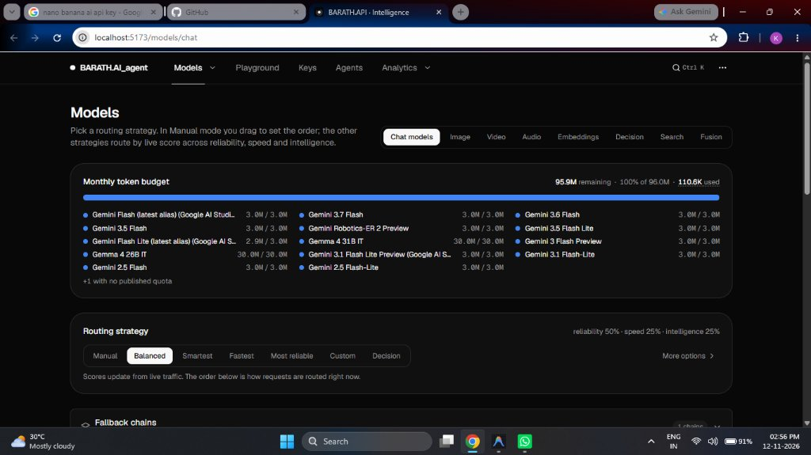

<div align="center">

# ⚡ BARATH.AI Agent

**Autonomous AI Agent Gateway & Free Multi-Cloud Inference Router**

Aggregate free tiers across 34 AI providers and 635 models behind one unified OpenAI & Anthropic compatible endpoint.



</div>

---

## 🚀 How to Run Simply (3 Steps)

### Step 1: Install Dependencies
Ensure you have **Node.js (v20+)** installed, then open PowerShell in the project root:

```powershell
npm install
```

---

### Step 2: Set Up Environment Variables (`.env`)
FreeLLMAPI uses a 32-byte encryption key for secure local storage of your API keys. Run this single command to create your `.env`:

```powershell
$ENCRYPTION_KEY = node -e "console.log(require('crypto').randomBytes(32).toString('hex'))"
"ENCRYPTION_KEY=$ENCRYPTION_KEY`nPORT=3001" | Out-File -Encoding utf8 .env
```

---

### Step 3: Start the Application
Run the client dashboard and backend server together:

```powershell
npm run dev
```

Once running, open your browser:
* 🌐 **Web Dashboard:** [http://localhost:5173](http://localhost:5173)
* ⚡ **API Gateway:** [http://localhost:3001/v1](http://localhost:3001/v1)

---

## 🔑 How to Add & Manage API Keys

1. Open the dashboard at [http://localhost:5173](http://localhost:5173) and click on the **Keys** tab in the top navigation.
2. Click **+ Add Key** for your preferred providers:
   * **Google AI Studio (Gemini):** [aistudio.google.com](https://aistudio.google.com/) *(Free high-token limits)*
   * **Groq:** [console.groq.com](https://console.groq.com/) *(Ultra-fast Llama 3 models)*
   * **Cerebras:** [cloud.cerebras.ai](https://cloud.cerebras.ai/) *(High-speed inference)*
   * **OpenRouter:** [openrouter.ai](https://openrouter.ai/) *(Free community models)*
   * **Mistral AI:** [console.mistral.ai](https://console.mistral.ai/)
3. Keys are encrypted with **AES-256-GCM** and stored securely in your local SQLite database.
4. Copy your **Unified API Key** from the header of the **Keys** page. This single key gives you access to all 635 models!

---

## 🤖 Using with AI Coding Agents

Point any coding tool or AI client to your local endpoint:

* **Base URL:** `http://localhost:3001/v1`
* **API Key:** `<your-unified-api-key>`

### Claude Code Setup
```bash
npx freellmapi setup-claude --url http://localhost:3001 --api-key <your-unified-key>
```

### Cursor / VS Code / Cline Setup
In your extension settings:
* **API Base URL:** `http://localhost:3001/v1`
* **API Key:** `<your-unified-key>`
* **Model:** `auto` *(or choose any model in your fallback chain)*

---

## 🛠️ Alternative Run Modes

* **Production Build:**
  ```powershell
  npm run build
  npm run start -w server
  ```
* **Docker Compose:**
  ```powershell
  docker compose up -d
  ```

---

<div align="center">
  <sub>Built with ❤️ by <b>BARATH.AI</b></sub>
</div>
